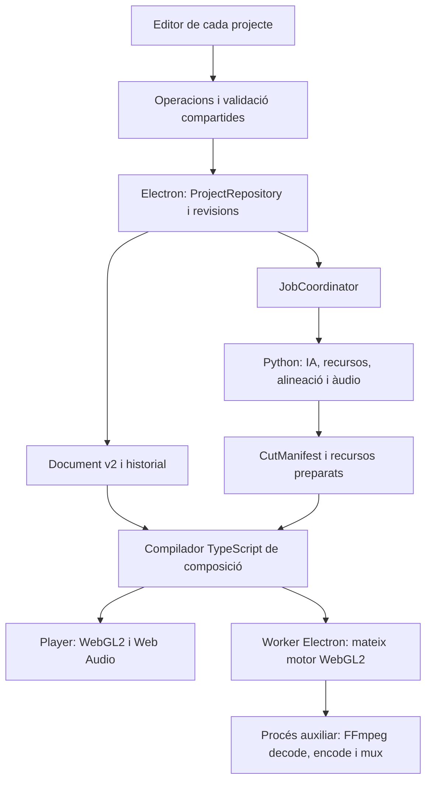

# Edity — Disseny tècnic de l’edició de media

Data: 30 de setembre de 2026. Estat: disseny proposat, pendent d’implementació.

Documents de partida: [especificació funcional](media-editing-specification.md) i [referències de Resolve](media-editing-reference.md).

## 1. Decisions principals

1. **Composició declarativa versionada:** el projecte desa elements, recursos, vincles amb el discurs i presets. No desa instruccions de renderitzat generades per la IA.
2. **Un motor visual TypeScript/WebGL2:** mateix avaluador, layout de text, shaders i presets al reproductor i al renderitzador d’exportació d’Electron.
3. **Mapa de retalls únic:** centralitzar el resultat del refinament actual de talls, utilitzar-lo al playback, als anchors, a la IA, als subtítols i a l’exportació.
4. **Àudio amb pla compartit:** conservar el sistema de veu precisa i compilar temps, fades i volums en un pla consumible per Web Audio i FFmpeg.
5. **Operacions transaccionals:** la IA i la interfície utilitzen les mateixes operacions validades. Una petició de la IA es desfà com una sola edició.
6. **Coordinació fora de les pestanyes:** Electron controla revisions, escriptures i tasques. Tancar un editor no interromp una tasca del projecte.

Prioritat d’implementació: comprovar aviat la reproducció i exportació amb el motor compartit. La resta de funcionalitats es construeixen sobre aquest camí verificat.

## 2. Situació actual i punts d’integració

Inspecció del repositori feta el 30 de setembre de 2026. Entorn local observat: Electron 33.4.11 i FFmpeg 7.1.1. Les API triades s’han de verificar amb aquesta versió empaquetada, encara que la documentació consultada sigui l’actual.

| Peça actual | Situació | Canvi previst |
| --- | --- | --- |
| `frontend/src/types/project.ts` | ProjectFile v1, MediaItem image/broll/music amb temps i volum | ProjectFile v2 i model de composició |
| `VideoPlayer.tsx` | Vídeo HTML, proxy base i hooks de veu; no composa media | Canvas de composició i capa de manipulació |
| `useInstantAudio.ts`, `instantTimeline.ts`, `playbackTime.ts` | Veu precisa i conversió entre temps d’origen i editat | Conservar el comportament, extreure rellotge i pla temporal |
| `cutRanges.ts`, `/preview/refine` | Retalls i refinament de fronteres | Servei únic de CutManifest, amb cache per revisió |
| `MediaPanel.tsx` | Afegir elements bàsics i recursos | Biblioteca, capes i inspector |
| `WaveformTimeline.tsx` | Vista d’àudio i retalls | Integrar la forma d’ona a la timeline de composició |
| `editorStore.ts` | Zustand amb zundo sobre tot l’estat | Separar document, estat de UI, runtime i historial |
| `aiStore.ts` | Instruccions i preferències persistides en localStorage | Perfils globals i còpia efectiva d’instruccions al projecte |
| `projectPersistence.ts`, `electron/project-store.js` | Autosave de snapshots sense comparació de revisió | Escriptor únic amb revisions i commits |
| `electron/main.js` | BrowserView independent per projecte | Reutilitzar l’aïllament; afegir coordinador de tasques |
| `backend/services/media.py` | Passada FFmpeg posterior a l’exportació | Importació de recursos; composició v2 al motor compartit |
| `backend/routers/export.py` | Jobs en memòria i cadena tall → Studio Sound → media | Adaptador al nou flux per a projectes v2 |
| `backend/services/ai_provider.py` | Proveïdor actual i resposta amb mediaIdeas | Orquestració d’accions de media amb contractes validats |
| `electron/project-archive.js` | Empaqueta paths de clips i mediaItems | Empaquetar assets, fonts, variants i composició v2 |

No cal substituir React, Zustand, el backend Python ni el proveïdor d’IA per incorporar aquest disseny.

## 3. Arquitectura



Responsabilitats:

- **Document:** dades editables, referències estables i versions.
- **Compilador:** resol anchors, intervals, fonts, preset versions i recursos; produeix un RenderPlan immutable.
- **Motor:** avalua un instant i dibuixa els elements. No coneix React, el xat ni els fitxers del projecte.
- **Adaptadors:** aporten frames i àudio al motor segons si es tracta de playback o exportació.
- **ProjectRepository:** única autoritat de revisions i escriptura de metadades.
- **JobCoordinator:** planifica tasques i aplica els seus resultats amb control de conflictes.

## 4. Model de dades v2

### 4.1 Document persistent

Mantenir les dades actuals de transcripció, clips, retalls i processament. Afegir:

```ts
type ProjectV2 = {
  version: 2;
  id: string;
  revision: number;
  transcriptRevision: number;
  composition: Composition;
  assets: Record<string, Asset>;
  presetVariants: Record<string, PresetVariant>;
  style: ProjectStyle;
  // Resta de dades del projecte actual, adaptades a v2.
};

type Composition = {
  schemaVersion: 1;
  canvas: { width: number; height: number; fps: { num: number; den: number } };
  tracks: Track[];
  elements: Record<string, Element>;
  transitions: Record<string, Transition>;
};
```

`revision` sempre creix, també en desfer. Les revisions identifiquen commits, no la posició de l’historial. `transcriptRevision` identifica canvis dels continguts o temps que afecten anchors i talls.

### 4.2 Recursos

Asset té `id`, `kind`, path relatiu gestionat, hash de contingut i metadades: durada, mida, fps racional, streams d’àudio, rotació, color i presència d’alfa. Inclou procedència local/URL, nom original, informació de font quan correspongui i versions dels derivats.

- Originals en `media/<assetId>.<ext>`; derivats en `cache/assets/<hash>/<profile>/`.
- Referenciar recursos per ID, mai amb URLs temporals al document de composició.
- Deduplicar la mateixa importació pel hash, mantenint metadades de procedència.
- La còpia/importació incorpora el recurs al projecte abans de publicar l’element que l’utilitza.
- Les fonts es resolen per família/pes/estil i hash del fitxer disponible. Si és possible incorporar-les al projecte, es carreguen des del mateix recurs al preview i al worker.

### 4.3 Elements

Unió discriminada `base | image | video | text | audio` amb camps comuns:

- ID, trackId, ordre dins de la pista, etiqueta i habilitació.
- Placement, propietats de transformació, llista ordenada d’efectes i animacions de preset.
- `createdBy: manual | ai | migration`, `operationId` i revisions de camps per reconciliar correccions.
- Recursos per `assetId`; text amb contingut i estil; àudio independent.

Transforms: posició i pivot normalitzats respecte del canvas, escala X/Y, rotació/pitch/yaw en graus, retall normalitzat i opacitat. Text: mides en píxels del canvas de disseny. El canvas s’escala proporcionalment per a preview/export; les unitats no depenen de la mida del panell.

Un `base` referencia un clip gestionat i un interval d’origen, no una còpia del vídeo. El compilador el fragmenta virtualment segons el CutManifest. La composició manté sempre la capa base subjacent, encara que un B-roll la cobreixi.

Els vídeos tenen sourceIn, política de final `hold | loop | trim` i controls d’àudio. No repetir-los implícitament: l’operació defineix la política. Música i sons tenen gainDb, mute i fades. Es pot desvincular l’àudio d’un vídeo amb un element d’àudio referenciant el mateix asset.

### 4.4 Presets i transicions

```ts
type PresetInstance = {
  presetId: string;
  presetVersion: number;
  params: Record<string, number | string | boolean>;
  seed?: number;
};
```

La versió fixa el comportament del preset. Una actualització del programa no modifica silenciosament les animacions d’un projecte existent. Camera Shake utilitza seed estable i temps del projecte, sense aleatorietat per frame.

Transition conté IDs de dos elements compatibles, frontera/anchor, durada sol·licitada, alineació i PresetInstance. La durada efectiva és derivada i pot reduir-se si no hi ha espai. Es poden configurar entrades/sortides d’un element sense crear una transició entre dos clips.

## 5. Temps i vincles amb el discurs

### 5.1 Convencions

- Persistir temps en microsegons enters; convertir a segons només a les API de reproducció.
- Intervals semioberts `[start, end)`. A una frontera exacta només pertany el frame al nou interval.
- `source`: temps local d’un clip estable; `edit`: temps després de la neteja.
- Rellotge del player en temps editat. Ressaltat de transcripció a través d’edit → clip/source.
- Exportació CFR a fps racional del canvas. Instant del frame n: `n * den / num`; no acumular decimals frame a frame.
- La durada de contingut és la del CutManifest. La representació al contenidor es quantitza amb una tolerància màxima d’un frame, sense afegir trams editorials.

### 5.2 CutManifest

Resultat immutable de la neteja i refinament existent:

```ts
type CutManifest = {
  id: string;
  inputRevision: string;
  durationUs: number;
  segments: Array<{
    clipId: string;
    sourceStartUs: number;
    sourceEndUs: number;
    editStartUs: number;
    editEndUs: number;
    joinInUs: number;
    joinOutUs: number;
  }>;
};
```

La clau de cache inclou hashes del vídeo/àudio, transcripció, marks, fronteres manuals, llengua i versió dels algoritmes. S’ha de reutilitzar el refinament actual, incloses les fronteres bloquejades i la protecció de paraules veïnes.

Publicar un sol manifest després del refinament. `useInstantAudio` i `ExportDialog` deixen de fer dues peticions independents per obtenir el mateix mapa. L’exportació fixa el manifest revisat; no torna a ajustar fronteres pel seu compte.

Mentre es calcula una nova revisió es pot continuar reproduint una revisió completa anterior. Si l’usuari vol veure el nou tall abans de resoldre’l, utilitzar el comportament provisional actual amb estat local de preparació; no bloquejar tot l’editor. Cap exportació v2 utilitza un mapa provisional sense resoldre.

### 5.3 Anchors

Afegir ID estable a cada Word. La correcció de puntuació conserva els IDs. Afegir un clip nou crea nous IDs sense renumerar els anteriors. Migració inicial determinista per clip i ordinal; retranscripció amb correspondència per temps/text i fallback a interval d’origen quan no hi ha correspondència fiable.

Placement és una unió:

- `speech`: wordIds d’inici/final, offsets signats i interval d’origen de reserva.
- `source`: clipId + interval local, útil per a transforms del vídeo base.
- `timeline`: inici/final editats absoluts; per a media antic i elements desvinculats.
- `project`: extensió sobre tot el projecte o offsets respecte d’inici/final; per a música general.

Resolució d’un anchor de frase:

1. Intersectar la seva cobertura d’origen amb els segments conservats.
2. Si no hi ha discurs conservat, marcar-lo com a suprimit pel retall, sense eliminar-lo del document.
3. Si queda part de la frase, definir l’interval entre la primera i l’última part conservada en temps editat, aplicant offsets i limitant a la durada del projecte.
4. En desfer el retall, recalcular a partir del document original.

No convertir permanentment anchors en segons editats després de cada tall. Això evitarà la deriva acumulada.

Un drag temporal d’un element vinculat ajusta els offsets respecte del seu anchor. L’inspector ofereix «desvincular de la frase» per passar a timeline absoluta. L’àudio general manté el seu sourceIn i es retalla o repeteix segons la política definida, sense accelerar-se per encaixar.

## 6. Motor visual compartit

### 6.1 Avaluació

`compileComposition(document, cutManifest, assetMetadata, registry)` produeix RenderPlan amb índex d’intervals, recursos necessaris, transicions resoltes i AudioPlan.

`evaluateFrame(plan, editTimeUs)` retorna capes actives, temps de cada recurs, matrices, opacitats, layout de text i passes d’efectes. És una funció pura. Preview i exportació importen el mateix paquet compilat.

Ordre de render:

1. Obtenir frames i textures dels recursos actius.
2. Generar textura de text al canvas de disseny.
3. Aplicar crop, keying i efectes de l’element en l’ordre desat.
4. Transformar l’element amb matriu de perspectiva i animació del preset.
5. Resoldre transicions sobre les dues capes/pistes que indiqui el document.
6. Compondre les capes per ordre, amb opacitat i alfa premultiplicada.

El reproductor té un canvas WebGL2 i, per sobre, una capa DOM de handles i selecció. Els textos finals no són overlays DOM. Canvas2D proporciona el layout i la rasterització del text en els dos entorns Chromium, amb fonts, salts de línia, contorn, ombra i fons idèntics.

WebGL2 és la base dels shaders i de la lectura dels frames finals. La lectura síncrona de píxels pot ser costosa; el camí d’exportació començarà amb backpressure i es podrà optimitzar amb buffers de lectura després de mesurar-lo. [Especificació WebGL2](https://registry.khronos.org/webgl/specs/latest/2.0/).

### 6.2 Fonts, alfa i color

- Esperar que la font concreta estigui carregada abans de publicar el resultat. Si falta, mostrar la substitució i desar quina s’ha aplicat; l’exportació utilitza la mateixa.
- Carregar el mateix fitxer de font en player i worker, quan estigui incorporat al projecte.
- Definir SDR Rec.709 de sortida i una conversió comuna cap a les textures RGB del compositor. Normalitzar rotació, aspecte de píxel i rang del vídeo durant la preparació.
- El MVP de color tracta fonts HDR amb un perfil explícit de conversió a SDR, amb el mateix derivat al player i a l’exportació; no promet una sortida HDR.
- Alfa premultiplicada en textures de composició i conversions explícites a l’entrada. Comprovar vores transparents sobre blanc i negre.
- Preparar un derivat compatible quan Chromium no descodifiqui l’original. Si un format amb alfa no es pot reproduir nativament, el frame provider del procés auxiliar aporta RGBA al mateix compositor; no aplanar-lo contra negre.

### 6.3 Presets

Registry de presets amb ID, versió, tipus, schema de paràmetres, defaults, límits, avaluador i passes de shader. El schema serveix per generar l’inspector i les capacitats que veu la IA.

Implementacions previstes:

- Fades/dissolve: opacitat i blend temporal.
- Grow/overshoot/settle i zooms: corbes pures segons progrés normalitzat.
- Gaussian Blur: passes separables amb intensitat definida en unitats del canvas.
- Camera Shake: moviment determinista segons seed, freqüència i intensitat.
- 3D Keyer: selecció de color, tolerància, suavitzat i spill amb shader; contrastar el comportament amb el preset de Resolve abans de donar-lo per equivalent.
- XIROCA: portar a avaluadors i shaders els transforms, blends, vores i blur de les definicions Favorites.

Les deu definicions `.setting` estan localitzades al paquet original. Fer-ne una lectura estàtica de referència i implementar només els nodes necessaris; no executar expressions externes com a codi ni construir un runtime general de Fusion.

El preset vertical combina transforms, moviment exponencial, blend al centre i blur direccional. Les altres variants necessiten comprovar les seves expressions individualment. Dark Box Text Lower Third i els efectes natius necessiten mostres visuals i controls de referència addicionals durant la implementació.

Variants d’usuari guarden presetId/version i overrides. Les variants utilitzades queden incorporades al projecte, encara que després s’esborrin de la biblioteca global.

### 6.4 Transicions sense canviar durada

Definir una finestra entorn de la frontera entre clips, sense moure el rellotge ni els temps dels clips. Fer el blend/moviment visual sobre aquella finestra.

- Utilitzar handles només si pertanyen a intervals conservats i autoritzats.
- Quan el material adjacent està eliminat, repetir el frame límit conservat per completar la finestra visual, o reduir la durada efectiva. No recuperar frames eliminats.
- Si la finestra envaeix una altra transició, limitar-la de manera determinista segons les fronteres disponibles i reflectir la durada efectiva a l’inspector.
- La transició visual no solapa, escurça ni repeteix la veu. L’àudio del discurs segueix exclusivament el CutManifest.

## 7. Playback i àudio

### 7.1 Rellotge i frames

PlaybackController per editor: editTime, playing, rate, manifestId i generació de seek. AudioContext proporciona el rellotge mentre hi ha reproducció; en pausa es conserva editTime explícit.

- Reutilitzar el camí de veu precisa actual, però els nodes de veu passen al bus del mesclador.
- Vídeo base i B-roll es sincronitzen contra el mateix rellotge. Un pool de decoders prepara els recursos actius i els següents; a les transicions calen dos frames disponibles.
- Preview amb HTMLVideo quan sigui compatible, i frames del worker per als formats que ho necessitin. Posició frame-aware i seeks cancel·lables; no dibuixar frames d’una generació anterior.
- Frame tardà: mantenir l’últim frame visual disponible, sense moure la veu per compensar-lo. Mostrar un estat local si la degradació persisteix.
- Transformar, moure o editar un text actualitza el següent frame sense tornar a codificar el vídeo.
- No pre-renderitzar tot el projecte cada vegada que es modifica un element.

### 7.2 AudioPlan

Pla amb intervals d’origen/editats, taxa, canals, gainDb, fades, mute i envelope de ducking. Fades de veu deriven del mateix perfil de joins que el sistema actual; no afegir pauses ni crossfades que alterin el temps.

- Àudio intern a 48 kHz. Conversions i arrodoniments definits sobre índexs de samples, calculats sobre la posició absoluta per evitar deriva.
- `gain = 10 ** (gainDb / 20)`; interpolar fades de guany de manera consistent entre adapters.
- Web Audio usa gains programats i un horitzó curt de scheduling, renovat durant playback. Àudios llargs es carreguen per fragments; no duplicar un AudioBuffer complet per cada element de música.
- Ducking es calcula una vegada a partir de la veu, amb attack/release i un envelope immutable. Els dos adapters consumeixen el mateix envelope; no usar dos detectors independents.
- Studio Sound s’aplica a la veu abans de la mescla, reutilitzant la cache actual i mantenint el nombre de samples/offsets. No passar música o efectes pel netejador de veu.
- Exportació consumeix l’AudioPlan per FFmpeg, amb guanys explícits i mescla sense normalització automàtica per nombre d’entrades.
- Capturar clipping i aplicar la mateixa política de guany final als dos camins. Els presets no canvien el volum de veu de manera implícita.

Si Studio Sound encara es prepara, l’editor continua usable i identifica que la veu és provisional. Exportar amb Studio Sound espera la seva preparació.

## 8. Exportació amb el mateix renderer

### 8.1 Components

- RenderWorker: BrowserWindow ocult, `show: false`, `contextIsolation: true`, `nodeIntegration: false`, preload específic i backgroundThrottling desactivat. Carrega només l’entrada local de render, sense la UI completa.
- MediaWorker: `utilityProcess` d’Electron que executa FFmpeg per descodificar i codificar, i controla streams binaris amb cues limitades.
- MessagePorts connecten directament MediaWorker i RenderWorker. El procés principal només coordina i rep progrés; no retransmet tots els frames.

Electron documenta l’ús de finestres ocultes com a workers i MessagePorts entre processos; els ports es transfereixen mitjançant `postMessage`, no `invoke`. [MessagePorts](https://www.electronjs.org/docs/latest/tutorial/message-ports), [utilityProcess](https://www.electronjs.org/docs/latest/api/utility-process), [BrowserWindow](https://www.electronjs.org/docs/latest/api/browser-window).

### 8.2 Flux

1. Fixar snapshot, revision, CutManifest i assets; comprovar recursos, fonts, presets i opcions abans d’exportar.
2. Preparar l’AudioPlan i la veu requerida amb Python; desar el manifest i els plans en fitxers de job.
3. Obrir sessions de descodificació FFmpeg per recursos actius. Descodificar seqüencialment i reposicionar només quan el mapa o sourceIn ho requereixi.
4. MediaWorker aporta frames RGBA amb assetId, timestamp i índex sol·licitat. Fonts VFR es resolen pel PTS al temps demanat, amb una política única de selecció de frame.
5. RenderWorker crida `evaluateFrame` i dibuixa amb el mateix compositor del preview. Retorna RGBA final, corregint l’orientació de readback.
6. MediaWorker escriu rawvideo a FFmpeg, que codifica a la resolució, fps i format escollits. La lectura/escriptura té backpressure, inicialment dos frames finals en vol com a màxim.
7. Mesclar àudio, muxar, incorporar subtítols si escau i validar els streams i durada de sortida.
8. Publicar el fitxer complet al destí, inclosos discos diferents, mitjançant staging al mateix directori de destí i substitució final. Conservar el fix existent per a SSD externs.

Frames i PCM circulen com a dades binàries; no JSON/base64. El protocol inclou seqüència, mida, format, timestamp, error i cancel·lació. Les cues de frames d’origen també estan limitades per un pressupost de bytes.

La sortida fixa CFR i fps racional explícits; FFmpeg permet seleccionar el mode de sincronització de vídeo. No basar el render exportat en timers de temps real ni en captures de la pantalla. [Documentació de FFmpeg](https://ffmpeg.org/ffmpeg.html).

Els filtergraphs i plans llargs van en fitxers, preservant el fix de WinError 206. Comandes amb arguments estructurats i processos ocults a Windows. Incloure stderr útil i etapa real en l’error del job.

### 8.3 Opcions i compatibilitat

- Stream copy només quan no cal composició, transforms, transicions o captions cremats i els talls són compatibles. La UI identifica el canvi necessari a re-encode.
- Per a v2 no utilitzar una segona implementació visual a `render_media`; els elements passen pel compositor compartit.
- Captions cremats es representen com una capa derivada al mateix compositor, visible al preview quan l’opció estigui activa. SRT sidecar utilitza el mateix mapa temporal.
- Sense media nou, mantenir el camí existent verificat fins que el nou camí superi les proves de regressió de retalls i veu.
- L’exportació no necessita mantenir oberta la pestanya del projecte, però sí l’app. Tancar l’app interromp el job; el seu estat queda recuperable al següent inici.

## 9. Interfície i estat

Components proposats:

- `CompositionPlayer`: canvas i adaptadors; substitueix el render visual de VideoPlayer conservant controls.
- `ViewerManipulationLayer`: selecció i handles DOM. Converteix coords del panell a coords del canvas, incloent letterboxing i inversa de perspectiva per hit testing.
- `CompositionTimeline`: ruler editat, posició, elements i forma d’ona; compacta per defecte i desplegable dins la columna del vídeo.
- `LayerList`: selecció de capes ocultes, ordre i mute/hide.
- `ElementInspector`: formularis segons tipus d’element i schema del preset.
- `PresetBrowser`: catàleg, previews curts i variants guardades.

UIState per editor amb selectedElementIds, hoveredId, zoom temporal, scroll i dragDraft. RuntimeState amb clock, decoders, caches i jobs. Cap d’aquests camps entra a l’historial del document.

Durant un drag, actualitzar un draft local per frame. A mouseup aplicar una operació i un sol pas de desfer. Escape cancel·la el draft. Edició de text similar, amb commit al final de la sessió.

La timeline usa els intervals compilats; no desa una segona còpia de les posicions derivades. Virtualitzar files/intervals visibles quan calgui. SelectionContext és específic del projecte i es passa explícitament a la IA.

## 10. Operacions, revisions i desfer

### 10.1 Contracte

```ts
type EditTransaction = {
  id: string;
  projectId: string;
  baseRevision: number;
  actor: 'manual' | 'ai' | 'migration';
  label: string;
  operations: CompositionOperation[];
};
```

Operacions: add/update/remove element, move/trim, reorder, set transform, set text/style, attach/update/remove preset, add/update/remove transition, set audio, set anchor i guardar variant. Les operacions d’IA no poden proporcionar shader, codi, comandes FFmpeg ni paths arbitraris en lloc d’assets.

Validar schema, IDs, disponibilitat d’assets, temps, tipus de pista, compatibilitat de transicions i params dels presets. Rebutjar NaN/infinits i intervals buits. Validar la transacció sencera abans de publicar-la.

### 10.2 Autoritat i conflictes

ProjectRepository d’Electron és l’únic escriptor de metadades. BrowserViews i jobs fan `commit(transaction)` amb baseRevision. El repositori publica l’ack i el nou document als editors del projecte.

- Si la revisió ha canviat, comparar camps tocats des de baseRevision.
- Rebase automàtic si les modificacions són independents.
- Si coincideixen sobre el mateix camp, l’edició manual més recent preval. La IA rep l’estat nou i replanifica aquella correcció, sense sobrescriure silenciosament.
- Una transacció ja aplicada torna el mateix ack per transactionId. IDs d’elements generats per requestId/action ordinal per evitar duplicacions en retries.
- beforeunload només buida operacions pendents; no sobreescriu un document amb un snapshot obsolet.

### 10.3 Historial

Guardar patches forward/inverse i label, amb un grup per petició de la IA. Desfer executa una transacció inversa amb nova revision. Una petició pot aplicar blocs parcials progressius, però tots comparteixen groupId i un pas de desfer.

Si entren edicions manuals entre blocs, agrupar la petició en l’historial sense eliminar els canvis manuals: els inversos actuen només sobre els camps que encara tenen el valor escrit per aquella petició; els conflictes es resolen explícitament.

Historial limitat en memòria i persistit en journal per conservar-lo en tancar/reobrir. Compactar amb snapshot i una finestra d’historial, sense esborrar assets referenciats per undo, variants o jobs actius.

Metadades i journal es publiquen amb fitxers temporals i una seqüència de commit recuperable. En iniciar, recuperar commits complets i descartar els incomplets. No donar un commit per confirmat a l’editor abans de tenir persistència.

## 11. IA i instruccions

### 11.1 Orquestració

Conservar el proveïdor actual. Afegir un MediaEditOrchestrator que fa un bucle amb accions JSON validades: observar → trobar/importar recursos → editar → verificar el pla → resumir.

El model veu:

- Instruccions permanents, snapshot del perfil escollit i indicacions específiques.
- Transcripció amb wordIds i temps source/edit del manifest actual.
- Composició, selecció, tram visible, assets analitzats i captures mostrejades del vídeo quan siguin necessàries.
- Registry de presets amb paràmetres disponibles i límits.
- Revisions i canvis manuals que ha de conservar.

Accions disponibles: query composition, query transcript, inspect frames, search local assets, search web assets, import candidate, apply edit transaction i inspect rendered sample. Respostes estructurades amb requestId/actionId; l’orquestrador executa les accions i en retorna els resultats al següent pas.

### 11.2 Instruccions i perfils

Perfils globals en un fitxer gestionat per Electron, amb ID, nom, text i revision. El projecte desa una còpia de les instruccions efectives i profileId/revision. Canviar un perfil global no modifica projectes oberts automàticament; aplicar-ne la nova versió és una acció explícita.

Migrar les instruccions existents sense reescriure-les. Les instruccions específiques ajusten el perfil; una petició puntual concreta ajusta la tasca actual.

### 11.3 Execució i correccions

- Aplicar les edicions directament després de validar-les; no produir mediaIdeas que requereixin botons d’aprovació.
- Per a «aquest text», donar al model el selectedElementId i l’editTime del projecte correcte.
- Per a una correcció local, enviar context suficient i evitar regenerar elements aliens al canvi.
- Preparar assets abans de crear elements que els necessiten; aplicar blocs coherents que ja es puguin reproduir.
- Conservar els blocs completats si falla un recurs posterior i marcar la petició partial; permetre reprendre sense duplicats o desfer tot el grup.
- Límit de rondes i timeout de job. Cancel·lació interromp procés IA i tasques filles i impedeix commits tardans, mitjançant generationId.
- Resum curt al xat; detall tècnic al log del job.

## 12. Recursos d’Internet i biblioteca

SearchResult conté candidateId, títol, pàgina d’origen, URL de descàrrega verificada, tipus i metadades disponibles. Separar cerca de descàrrega. El proveïdor actual pot continuar fent cerca web; l’importador comprova que el resultat sigui un fitxer usable i no només una pàgina.

- Reutilitzar les comprovacions actuals de HTTPS públic, redireccions, MIME, extensió i mida.
- Afegir sniff/probe real, cancel·lació, retries limitats, límit de bytes per tipus i importació a `.partial` amb publicació final.
- No declarar llicències que no s’han verificat; conservar les dades de procedència que el proveïdor hagi trobat.
- Local catalog compartit per hash/version, però les seleccions i assets usats són de cada projecte.
- Preparació per asset: probe → còpia → thumbnail/contact sheet → proxy/frame provider → àudio. Jobs independents i reutilitzables.
- Asset desaparegut o incompatible: estat missing/failed amb opció de substituir; no exportar un resultat incomplet com si fos correcte.

## 13. Tasques i paral·lelisme

JobCoordinator a Electron, persistent en `jobs/`, amb projectId, jobId, parentId, revision, dependències, progress, etapa, result i error. Python executa serveis; no sobreescriu directament project.edity.

Estats: queued, waiting, running, complete, partial, failed, cancelling, cancelled, interrupted. Waiting identifica una dependència concreta: transcripció, vídeo net, asset o veu millorada.

Defaults inicials ajustables després de mesurar:

| Recurs | Límit inicial |
| --- | --- |
| Jobs IA | 2 globals, 1 que modifiqui media per projecte |
| Downloads | 4 globals |
| Preparacions pesades de vídeo/àudio | 2 globals |
| Export compositor | 1 global |
| Reproductors | Actius als panells visibles; decoders inactius alliberats |

Els límits són pressupostos de recursos, no una restricció al nombre de projectes. Cues justes entre projectes i prioritat per als recursos necessaris al playback visible. Ajustar resolució de proxy o concurrency quan hi ha pressió de memòria; no degradar la semàntica dels efectes.

Tancar una pestanya elimina player/decoders, però deixa els jobs. Eliminar un projecte cancel·la tots els seus jobs abans d’enviar-lo a la paperera. La carpeta i els handles de recursos no s’alliberen fins que els processos confirmen la cancel·lació.

Després d’un reinici, jobs running passen a interrupted. Importacions i preparacions poden reprendre per hash; exportació reinicia sobre l’snapshot fixat si els recursos continuen disponibles. Un job cancel·lat no reapareix com a queued.

Cache LRU global amb pressupost de bytes, leases per editors i jobs i invalidació per hash/versió. Assets originals no són cache. Fonts/textures immutables es poden compartir; rellotge, selecció, nodes d’àudio i estat dels decoders són de cada editor.

## 14. Persistència, migració i arxius

1. Afegir schema v2 i migrador pur v1 → v2. Obrir l’original sense modificar-lo fins que la conversió estigui validada.
2. Backup únic del document v1 abans del primer desat v2; migració atòmica i repetible.
3. Afegir wordIds i traduir mediaItems antics a elements amb placement timeline, conservant temps editats, sourceStart, ordre i volum lineal convertit a dB; volum 0 es representa com mute.
4. Conservar el comportament antic d’imatges/B-roll centrat amb fit i padding negre, B-roll silenciat i loop implícit convertit en política explícita. No canviar l’aparença de l’exportació existent durant la migració.
5. Afegir base, pistes i assets. Preservar processament pendent, clips, chat, aiSettings i retalls.
6. Actualitzar create/open/save/list/duplicate/import/export i la migració de carpetes antigues; aquests camins actualment comproven version 1 o només copien mediaItems.
7. Archives v2 incorporen paths relatius, assets/fonts, variants i versions requerides; remapejar IDs del projecte duplicat quan correspongui i validar referències en importar.
8. Si es rep una versió futura desconeguda, obrir només en mode d’inspecció o informar de la incompatibilitat; no perdre camps desant-la com a v2.

El journal i la cache no formen part obligatòria d’un archive portable. El snapshot, els assets i els presets utilitzats sí. La migració és del format d’Edity; no és un importador de projectes Resolve.

## 15. Fitxers i contractes a crear

Noms proposats; no són fitxers ja implementats.

| Zona | Peces |
| --- | --- |
| `shared/` | composition-schema.json, operations-schema.json, preset schemas i vectors de temps/validació |
| `frontend/src/composition/` | types, compiler, timeMap, anchors, operations, validation, presetRegistry |
| `frontend/src/render/` | compositor WebGL2, shaders, textRasterizer, textureCache, frameProviders |
| `frontend/src/playback/` | PlaybackController, AudioMixer, audioPlanAdapter, decoderPool |
| `frontend/src/components/` | CompositionPlayer, CompositionTimeline, ElementInspector, LayerList, PresetBrowser |
| `frontend/src/render-worker/` | entrada de render sense UI i protocol binari |
| `electron/` | project-repository, composition-migration, job-coordinator, media-worker, render-worker-manager, render-preload |
| `backend/services/` | composition_models, cut_manifest, audio_plan_renderer, media_edit_orchestrator, asset_preparation |
| `backend/routers/` | adaptadors per manifest, preparació d’àudio/assets i accions IA |

Schemas són la font dels contractes; validar també a Python amb models corresponents i fixtures compartides. Evitar dues lògiques d’anchors o presets, una en Python i l’altra en TypeScript: Python consumeix el pla ja resolt.

IPC nou:

- `project:getDocument(projectId)`
- `project:commit(transaction)` → revision + patch/document
- `project:undo/redo(projectId)`
- `job:start/cancel/get/subscribe(...)`
- `profiles:list/save/apply(...)`
- `render:openChannel(jobId)` → MessagePort autenticat per al worker esperat

Els canals validen l’editor/projecte emissor. Els workers reben només recursos autoritzats del seu snapshot, amb tokens/IDs de job; no exposar un shell o accés arbitrari des de la pàgina de render.

## 16. Pla d’implementació i comprovacions

### Fase 0 — Prova del camí compartit

Compositor petit amb base, PNG alfa i text. Player i worker dibuixen els mateixos instants. Export curt amb FFmpeg i MessagePorts; mesurar decode, render, readback, còpies IPC i encode a 1080p i 4K. Comprovar que l’app continua usable exportant en un SSD extern.

**Gate:** si aquest camí és massa lent, ajustar transport/readback/proxies abans d’estendre el catàleg. No introduir un motor d’exportació divergent per avançar més ràpid.

### Fase 1 — Dades, temps i persistència

Schema v2, IDs estables, CutManifest, anchors, operacions, revisions, journal i migració. Fixtures de v1 amb media, diversos clips i projectes en processament. Regresió dels talls que havien perdut «okay», inici de «before» o «software».

**Gate:** mateix temps i paraules conservades al playback/export, amb anchors que segueixen el discurs i roundtrip de projectes/archives sense pèrdues.

### Fase 2 — Edició manual completa

Player, timeline compacta/desplegable, inspector, imatges, B-roll, text, transforms, música i fades. Les operacions manuals verifiquen el motor abans de connectar-hi la IA.

**Gate:** exemples de diagrama, gameplay + captura + logo, text amb contorn/ombra i notificació alfa amb àudio independent; comparació preview/export i desfer/reobrir.

### Fase 3 — Presets Favorites

Registry, variants, animacions de text/zoom, fades/dissolve, XIROCA i efectes natius. Clips de referència mostrejats a inici, quart, centre, tres quarts i final, amb diverses durades/resolucions.

**Gate:** cada preset ofert té implementació als dos camins i paràmetres funcionals. XIROCA contrastat amb les definicions originals i el resultat de Resolve; possibles diferències visuals documentades abans de declarar equivalència.

### Fase 4 — IA autònoma i recursos

Accions validades, importació local/web, perfils, edicions directes, correccions, progress i retries. Provar el comportament complet amb el proveïdor real configurat, no només amb mocks.

**Gate:** petició d’edició completa sense confirmacions per element; correcció puntual; recurs fallit amb alternativa; retry sense duplicats; una petició es pot desfer.

### Fase 5 — Concurrència i empaquetat

Integrar jobs fora de BrowserViews, pressupostos de recursos, cancel·lació i recuperació. Dos editors visibles mentre un tercer processa/exporta; editar manualment durant una resposta de la IA; tancar pestanya; eliminar projecte amb job actiu.

**Gate:** estat independent, cap overwrite de snapshots antics, cap commit tardà després de cancel·lar i executables empaquetats amb shaders, worker, schemas i fonts/recursos necessaris.

### Mètode de verificació

- Unitàries sobre riscos concrets: límits temporals, anchors parcials, determinisme de presets, migració i conflictes de revisions.
- Comparació de frames del player i worker al mateix instant i resolució; contrastar textures/fonts/transforms abans de comparar el vídeo comprimit amb tolerància de còdec.
- Comparació d’AudioPlan i PCM: sample count, fades, posició, guany i ducking; escolta dels joins de veu.
- QA manual de manipulació, selecció de capes tapades, timeline, screen split i correccions IA.
- Prova sobre l’executable que obre la drecera de l’escriptori quan s’entregui implementació, amb exportació real al SSD.

## 17. Riscos que cal resoldre durant la implementació

| Risc concret | Resposta prevista |
| --- | --- |
| Transferència RGBA i readback lents, sobretot a 4K | Prova a fase 0, cues limitades, buffers i reducció de còpies; mesurar abans d’optimitzar |
| Diferències de color/frames entre decoder Chromium i FFmpeg | Derivats normalitzats, selecció PTS definida i comparacions sobre fixtures |
| Formats alfa no suportats pel player natiu | Frame provider RGBA compartit amb el worker |
| Fonts diferents o que desapareixen | Identitat/hash de font, càrrega comuna i substitució explícita |
| Algunes macros Favorites no equivalen a un efecte simple | Portar les definicions individuals i comparar visualment |
| Retalls refinats després de col·locar media | Manifest immutable i anchors d’origen, sense segons derivats persistits |
| Edicions manuals mentre la IA treballa | CAS per revision, conflictes per camp i replanificació |
| Molts projectes saturen RAM/GPU | Pool global amb pressupost, decoders només actius i tasques en cua |

Aquest document fixa l’arquitectura i les comprovacions. El rendiment, la paritat visual amb Resolve i el comportament del worker en l’Electron empaquetat encara s’han de demostrar amb la implementació.
